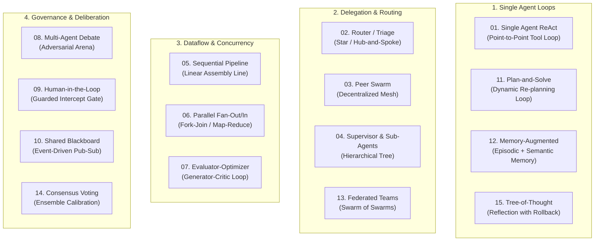

# 🧠 Agent Methods

> **An interactive educational testbed of 15 multi-agent architectures, communication topologies, and orchestration patterns powered by DeepSeek via the OpenAI Agents SDK.**

[](https://www.python.org/downloads/)
[](https://deepseek.com)
[](https://github.com/openai/openai-agents-python)
[](https://opensource.org/licenses/MIT)

`agent-methods` provides concrete, production-grade implementations of the foundational communication topologies used by autonomous multi-agent systems. All model calls are powered by **DeepSeek** (`deepseek-chat` / DeepSeek-V3) routed through the official **OpenAI Agents SDK**, demonstrating how modern agent frameworks cleanly decouple orchestration logic from model backends.

---

## ⚡ Quickstart

### 1. Clone & Set Up
```bash
git clone https://github.com/garyamorris/agent-methods.git
cd agent-methods

# Using uv (recommended)
uv venv --python 3.12
source .venv/bin/activate
uv pip install -e ".[dev]"

# Or using standard pip
python3 -m venv .venv
source .venv/bin/activate
pip install -e ".[dev]"
```

### 2. Configure Your DeepSeek API Key
```bash
cp .env.example .env
# Set in .env:
# DEEPSEEK_API_KEY=sk-...
```

*(Note: You can also export `DEEPSEEK_API_KEY="sk-..."` in your shell or set `OPENAI_API_KEY` as a fallback).*

### 3. Launch the Interactive CLI or Visualizer
```bash
# Launch interactive terminal menu
python main.py

# Launch interactive browser topology visualizer
python main.py visualizer

# Run performance benchmark suite
python main.py benchmark
```

---

## 🗺️ The 15 Agent Communication Topologies



| # | Pattern Name | Communication Topology | Real Public APIs & Execution | Dual Production Scenarios |
| :-: | :--- | :--- | :--- | :--- |
| **01** | [**Single Agent ReAct**](src/agent_methods/patterns/p01_single_agent_react.py) | Point-to-Point Tool Loop | CoinGecko Live API, Open-Meteo Weather API | **1:** Crypto Portfolio 1-day 95% Parametric VaR<br/>**2:** Global Maritime Shipping Port Weather Hazards |
| **02** | [**Router / Triage Dispatcher**](src/agent_methods/patterns/p02_router_triage.py) | Star (Hub & Spoke) | GitHub REST API, HackerNews Algolia, Real HTTP Socket Pings | **1:** Frontline Open-Source Tech Health Triage<br/>**2:** Multi-Tier Infrastructure Incident Dispatch |
| **03** | [**Peer-to-Peer Swarm**](src/agent_methods/patterns/p03_peer_handoffs.py) | Mesh Network | Nominatim Geocoding, Open-Meteo Climate, Wikipedia REST API | **1:** Tokyo Cultural Journey & Live Meteorology<br/>**2:** Nordic Expedition Planning (Reykjavik) |
| **04** | [**Supervisor & Sub-Agents**](src/agent_methods/patterns/p04_supervisor_subagents.py) | Hierarchical Tree | GitHub REST API, HackerNews Sentiment, SaaS Unit Economics | **1:** Astral `uv` Ecosystem Due-Diligence Briefing<br/>**2:** FastAPI Commercial Enterprise Adoption |
| **05** | [**Sequential Pipeline**](src/agent_methods/patterns/p05_pipeline_sequential.py) | Linear Assembly Line | GitHub Releases API, GitHub Issues API | **1:** Flask Official GitHub Release Notes Pipeline<br/>**2:** Astral `uv` Issue Triage & Engineering Digest |
| **06** | [**Parallel Fan-Out / Fan-In**](src/agent_methods/patterns/p06_parallel_fanout_fanin.py) | Fork-Join (Scatter-Gather)| GitHub REST API, HackerNews Algolia, CoinGecko Live API | **1:** Ethereum Institutional Infrastructure Risk Matrix<br/>**2:** Solana Enterprise Infrastructure Risk Matrix |
| **07** | [**Evaluator-Optimizer**](src/agent_methods/patterns/p07_evaluator_optimizer.py) | Cyclic Feedback Loop | Python AST Compiler Sandbox, In-Memory Test Assertions | **1:** Self-Healing LRU Cache with Real Test Assertions<br/>**2:** Self-Healing Token Bucket Rate Limiter |
| **08** | [**Multi-Agent Debate**](src/agent_methods/patterns/p08_debate_consensus.py) | Conversational Arena | GitHub REST Repo Adoption, HackerNews Engineering Post-Mortems | **1:** Modular Monolith vs Microservices Showdown<br/>**2:** Core Ledger Database Architecture (Postgres vs DynamoDB) |
| **09** | [**Human-in-the-Loop & Guardrails**](src/agent_methods/patterns/p09_human_in_the_loop.py) | Guarded Intercept Gate | SHA256 Backup Disk Audit, Input/Output Guardrails | **1:** Payments Database Schema Migration Gate<br/>**2:** Analytics DB Indexing with Approval Checkpoint |
| **10** | [**Event-Driven Blackboard**](src/agent_methods/patterns/p10_shared_blackboard.py) | Shared Memory Pub-Sub | Real HTTP Latency Sockets (`httpx`), HackerNews Outage Intel | **1:** Real-Time Cloud Network Latency Spike & SRE Triage<br/>**2:** API Gateway Degradation & Edge Failover |
| **11** | [**Dynamic Plan-and-Solve**](src/agent_methods/patterns/p11_plan_and_solve.py) | Closed-Loop Plan Controller| GitHub REST Contents API, Python AST Nodes, HackerNews CVEs | **1:** Flask Codebase Modernization Plan-and-Solve<br/>**2:** Astral `uv` Modernization Audit & Health Inspection |
| **12** | [**Memory-Augmented Architecture**](src/agent_methods/patterns/p12_memory_augmented.py) | Multi-Tier Cognitive Memory| Persistent Disk JSONL Store, Live GitHub Profile API, Semantic Rules| **1:** Personalized Software Architecture Recommendation<br/>**2:** Policy-Compliant Deployment Scheduler |
| **13** | [**Federated Multi-Team Swarm**](src/agent_methods/patterns/p13_federated_teams.py) | Swarm of Swarms | GitHub REST API (Eng), HackerNews Algolia (Marketing) | **1:** Astral `uv` Product Launch Federation<br/>**2:** OpenAI Agents SDK Platform Commercial Launch |
| **14** | [**Consensus Voting & Calibration**](src/agent_methods/patterns/p14_consensus_voting.py) | Ensemble Electoral College | GitHub REST API (Purist & SRE), CoinGecko Live API (Quant) | **1:** Enterprise Dependency Adoption Vote (Astral `uv`)<br/>**2:** Treasury Asset Allocation Consensus (Ethereum) |
| **15** | [**Tree-of-Thought with Rollback**](src/agent_methods/patterns/p15_reflection_tree_search.py) | Branching Search Tree | GitHub REST API Adoption Metrics, Python AST Syntax Validation | **1:** High-Throughput Distributed Rate Limiting Search<br/>**2:** Enterprise Vector Database Architecture Search |

---

## ⚖️ Trade-off Decision Matrix

| Pattern | Topology | Latency | Token Cost | State Isolation | Blast Radius | Best Suited For |
| :--- | :--- | :---: | :---: | :---: | :---: | :--- |
| **01. Single ReAct** | Tool Loop | Low | Low | Low | Contained | Straightforward calculations, single APIs |
| **02. Router / Triage** | Star Hub | Low | Low | Moderate | Low | Multichannel Customer Support, Helpdesks |
| **03. Peer Swarm** | Mesh Network | Moderate | Moderate | Low | Moderate | Fluid exploratory journeys (Travel, Brainstorming) |
| **04. Supervisor** | Tree Hierarchy | Moderate | Moderate | High | Low | Complex strategy, multi-domain planning |
| **05. Sequential Pipeline**| Linear Chain | Moderate | Moderate | High | Low | Publishing, ETL, Code migration |
| **06. Parallel Fan-Out** | Fork-Join | Fast (Concurrent)| High | Absolute | Isolated | Risk audits, comprehensive multi-angle reviews |
| **07. Evaluator-Optimizer**| Cyclic Loop | High (Multi-turn)| High | Moderate | Low | High-assurance code, SQL synthesis, contracts |
| **08. Multi-Agent Debate** | Roundtable Arena| High | High | Low | Low | Ambiguous architectural decisions, policy |
| **09. Human-in-the-Loop** | Intercept Gate | Variable (Human)| Low | High | Minimal | Database wipes, financial operations, compliance |
| **10. Shared Blackboard** | Pub-Sub Store | Moderate | Moderate | Decoupled | Low | SOC incident response, multi-sensor autonomy |
| **11. Plan-and-Solve** | Closed-Loop Plan| High (Adaptive) | High | High | Low | Multi-step software refactoring, scientific search |
| **12. Memory-Augmented** | Cognitive Tiers | Low | Low | High | Low | Persistent executive assistants, CRM profiles |
| **13. Federated Teams** | Swarm of Swarms| Moderate | Moderate | High | Isolated | Enterprise organizations mirroring Conway's Law |
| **14. Consensus Voting** | Blind Ensemble | Fast (Concurrent)| High | Absolute | Minimal | High-stakes zero-day CVE scoring, fraud triage |
| **15. Tree-of-Thought** | Branching Search| High (Search) | High | High | Resilient | Heuristic path planning, combinatorial optimization |

---

## 🌐 Interactive Browser Visualizer

Launch the interactive visual topology lab:
```bash
python main.py visualizer
```
Opens an interactive dashboard on `http://localhost:8000` with:
- Live SVG message-passing topologies and animated packet routing.
- Metric comparison cards (Latency, Token Cost, Isolation, Blast Radius).
- Step-by-step playback simulation and code inspection.

---

## 📚 Deep-Dive Educational Guides

- 📖 [**Multi-Agent Architecture Guide**](docs/ARCHITECTURE_GUIDE.md): Deep-dive analysis of communication mechanics, context hygiene, and common anti-patterns.
- 🛠️ [**OpenAI Agents SDK Primer**](docs/OPENAI_AGENTS_SDK_PRIMER.md): Complete guide to `Agent`, `Runner`, `handoff`, `as_tool`, and `guardrails`.
- 📁 [**Pattern Writeups Directory**](docs/patterns/): Dedicated markdown guides and Mermaid diagrams for every pattern.

---

## 🧪 Automated Testing

```bash
# Run complete test suite (32 tests verifying imports, structures, models)
pytest tests/
```

---

## 📄 License

MIT License. Created by [Gary Morris](https://github.com/garyamorris).
Contributions and architectural discussions are welcome!
