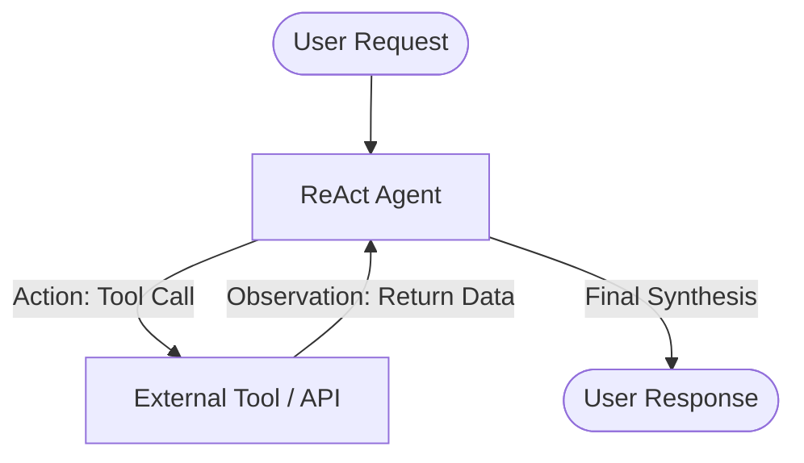
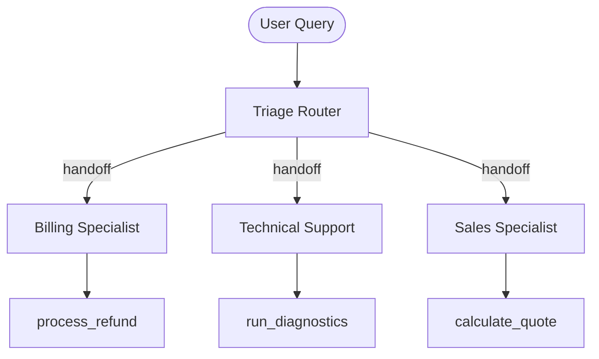
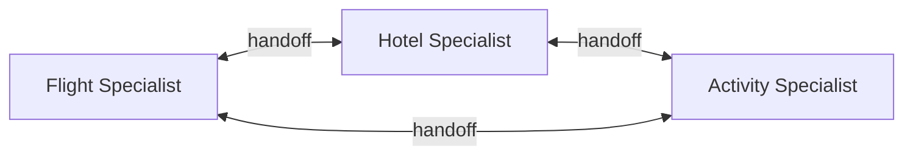
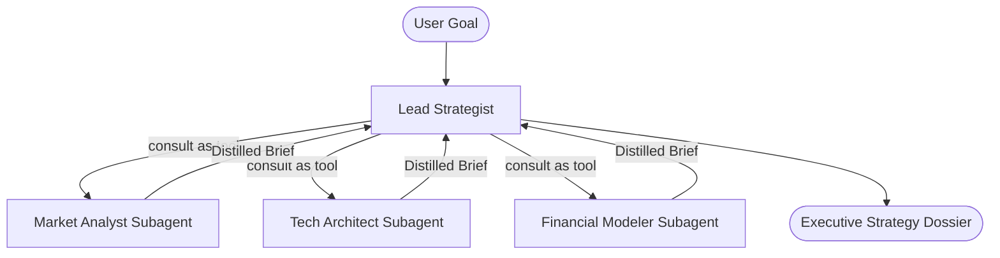
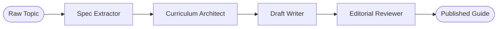
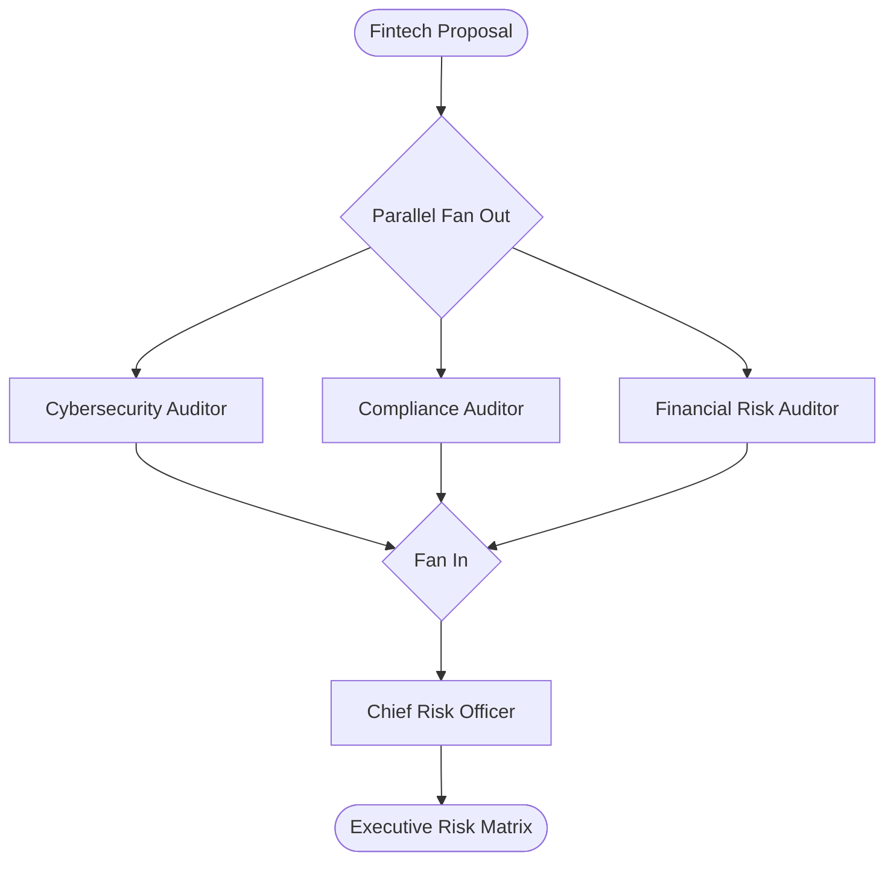
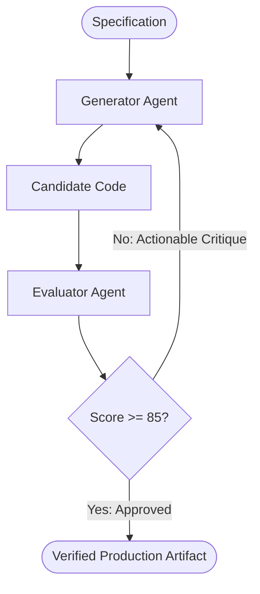
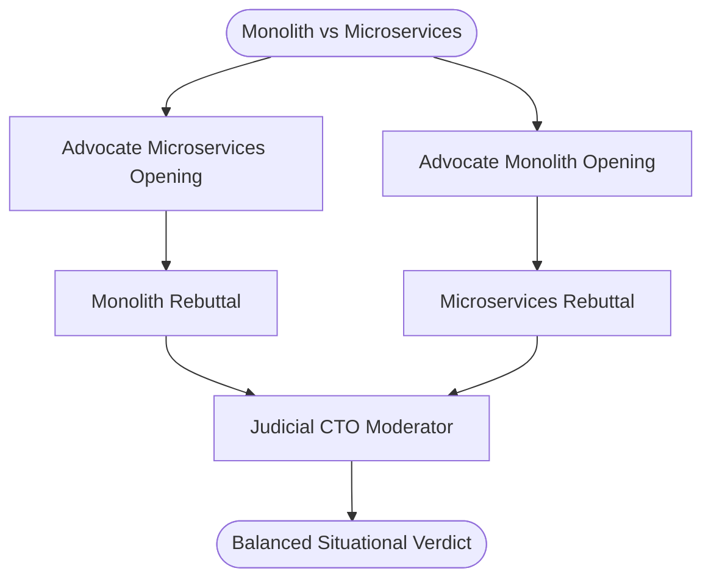
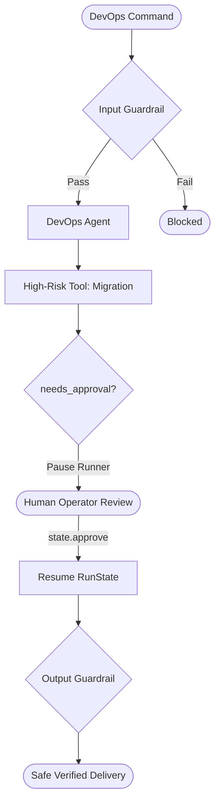
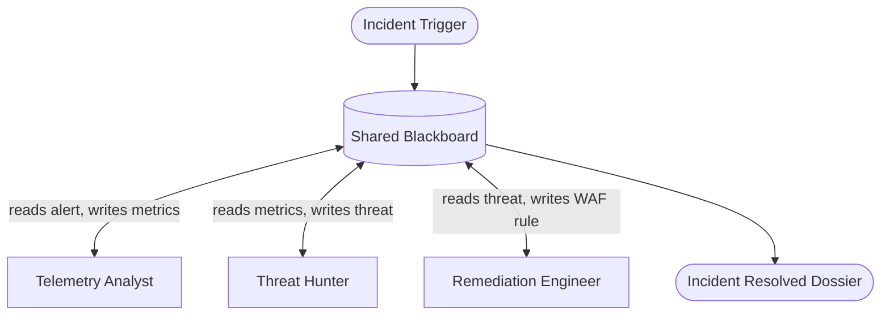

# 🧠 Agent Methods

> **An interactive educational testbed of multi-agent architectures, communication topologies, and orchestration patterns built with the official OpenAI Agents SDK.**

[](https://www.python.org/downloads/)
[](https://github.com/openai/openai-agents-python)
[](https://opensource.org/licenses/MIT)

`agent-methods` provides concrete, production-grade implementations of the foundational communication topologies used by autonomous multi-agent systems. Rather than viewing agents as mysterious monoliths, this repository breaks down **how agents talk to each other**, **how context flows across agent boundaries**, and **when to use each architecture pattern**.

---

## ⚡ Quickstart

### 1. Clone & Set Up
```bash
git clone https://github.com/garyamorris/agent-methods.git
cd agent-methods

# Using uv (recommended)
uv venv --python 3.12
source .venv/bin/activate
uv pip install -e ".[dev]"

# Or using standard pip
python3 -m venv .venv
source .venv/bin/activate
pip install -e ".[dev]"
```

### 2. Set Your OpenAI API Key
```bash
cp .env.example .env
# Edit .env with your OpenAI API key:
# OPENAI_API_KEY=sk-proj-...
```

### 3. Launch the Interactive CLI Lab
```bash
python main.py
```

Or run any architecture directly:
```bash
# Run Pattern 01 (ReAct)
python main.py run 1

# Run Pattern 04 (Supervisor & Subagents)
python main.py run 4

# View architecture explainer and diagram
python main.py explain 4
```

---

## 🗺️ The 10 Agent Communication Topologies

| # | Pattern Name | Communication Topology | OpenAI Agents SDK Primitive | Primary Use Case |
| :-: | :--- | :--- | :--- | :--- |
| **01** | [**Single Agent ReAct**](#pattern-01-single-agent-react) | Point-to-Point Tool Loop | `Agent`, `@function_tool`, `Runner.run` | Single-domain data lookup & computation |
| **02** | [**Router / Triage Dispatcher**](#pattern-02-router--triage-dispatcher) | Star (Hub & Spoke) | `Agent(handoffs=[...])` | Enterprise helpdesk & intent routing |
| **03** | [**Peer-to-Peer Swarm**](#pattern-03-peer-to-peer-swarm) | Mesh Network | Bidirectional `handoffs` | Fluid, multi-step customer journeys |
| **04** | [**Supervisor & Sub-Agents**](#pattern-04-supervisor--sub-agents) | Hierarchical Tree | `subagent.as_tool(...)` | Multidisciplinary executive planning |
| **05** | [**Sequential Pipeline**](#pattern-05-sequential-pipeline) | Linear Assembly Line | Chained `Runner.run(...)` | Publishing, code generation, ETL |
| **06** | [**Parallel Fan-Out / Fan-In**](#pattern-06-parallel-fan-out--fan-in) | Fork-Join (Scatter-Gather)| `asyncio.gather(*runners)` | High-speed multi-perspective risk audits |
| **07** | [**Evaluator-Optimizer**](#pattern-07-evaluator-optimizer) | Cyclic Feedback Loop | Pydantic Schemas + Iteration Gate | Algorithmic code synthesis & contract review |
| **08** | [**Multi-Agent Debate**](#pattern-08-multi-agent-debate--deliberation) | Conversational Arena | Cross-rebuttal turn orchestration | High-stakes architectural decision analysis |
| **09** | [**Human-in-the-Loop & Guardrails**](#pattern-09-human-in-the-loop--safety-guardrails) | Guarded Intercept Gate | `@input_guardrail`, `needs_approval=True` | Destructive mutations & sensitive commands |
| **10** | [**Event-Driven Blackboard**](#pattern-10-event-driven-shared-blackboard) | Shared Memory Pub-Sub | Central state model + reactive agents | Complex SOC cyber-incident triage |

---

## 🔬 Architecture Topologies & Code Walkthrough

### Pattern 01: Single Agent ReAct
Autonomous loop where the agent perceives the context, invokes external tools, and incorporates observations until reaching a final synthesis.


* **Source:** [`src/agent_methods/patterns/p01_single_agent_react.py`](src/agent_methods/patterns/p01_single_agent_react.py)

---

### Pattern 02: Router / Triage Dispatcher
A frontline classifier evaluates user intent and passes ownership of the conversation to a domain specialist (Billing, Technical Support, or Sales). The router then exits the conversation loop.


* **Source:** [`src/agent_methods/patterns/p02_router_triage.py`](src/agent_methods/patterns/p02_router_triage.py)

---

### Pattern 03: Peer-to-Peer Swarm
Agents interact as equals in a decentralized mesh. Any peer (Flight Specialist, Hotel Specialist, Activity Specialist) can hand off conversation control to any other peer as the user's focus shifts.


* **Source:** [`src/agent_methods/patterns/p03_peer_handoffs.py`](src/agent_methods/patterns/p03_peer_handoffs.py)

---

### Pattern 04: Supervisor & Sub-Agents (Orchestrator-Workers)
A central supervisor coordinates specialized sub-agents packaged as callable tools using `subagent.as_tool()`. The supervisor retains conversational control at all times, preventing verbose subagent logs from polluting the user context (**Context Hygiene**).


* **Source:** [`src/agent_methods/patterns/p04_supervisor_subagents.py`](src/agent_methods/patterns/p04_supervisor_subagents.py)

---

### Pattern 05: Sequential Pipeline (Assembly Line)
A deterministic multi-stage conveyor belt ($A \to B \to C \to D$). Each stage specializes in one transformation: Spec Extractor $\to$ Curriculum Architect $\to$ Tutorial Writer $\to$ Editorial Reviewer.


* **Source:** [`src/agent_methods/patterns/p05_pipeline_sequential.py`](src/agent_methods/patterns/p05_pipeline_sequential.py)

---

### Pattern 06: Parallel Fan-Out / Fan-In
Executes multiple independent specialized agents concurrently via `asyncio.gather()`, then folds all parallel outputs into a synthesis agent. Minimizes wall-clock latency.


* **Source:** [`src/agent_methods/patterns/p06_parallel_fanout_fanin.py`](src/agent_methods/patterns/p06_parallel_fanout_fanin.py)

---

### Pattern 07: Evaluator-Optimizer (Generator-Critic)
A Generator agent drafts a candidate solution, and an Evaluator agent scores it against objective criteria using structured JSON schemas. If below threshold, feedback loops back to the Generator until quality convergence.


* **Source:** [`src/agent_methods/patterns/p07_evaluator_optimizer.py`](src/agent_methods/patterns/p07_evaluator_optimizer.py)

---

### Pattern 08: Multi-Agent Debate & Deliberation
Pits two adversarial advocate agents against each other across opening and rebuttal rounds, after which an impartial judge synthesizes a nuanced, contextual verdict.


* **Source:** [`src/agent_methods/patterns/p08_debate_consensus.py`](src/agent_methods/patterns/p08_debate_consensus.py)

---

### Pattern 09: Human-in-the-Loop & Safety Guardrails
Defense-in-depth safety pattern: `@input_guardrail` rejects prompt injections, high-risk tools (`needs_approval=True`) pause the runner for human confirmation via `RunState`, and `@output_guardrail` blocks secret leaks.


* **Source:** [`src/agent_methods/patterns/p09_human_in_the_loop.py`](src/agent_methods/patterns/p09_human_in_the_loop.py)

---

### Pattern 10: Event-Driven Shared Blackboard
Agents do not call each other directly ($O(N^2)$ decoupling). They observe and write to a shared centralized memory repository (Blackboard) containing alerts, telemetry, verified facts, and applied mitigations.


* **Source:** [`src/agent_methods/patterns/p10_shared_blackboard.py`](src/agent_methods/patterns/p10_shared_blackboard.py)

---

## ⚖️ Trade-off Decision Matrix

| Pattern | Topology | Latency | Token Cost | State Isolation | Blast Radius | Best Suited For |
| :--- | :--- | :---: | :---: | :---: | :---: | :--- |
| **01. Single ReAct** | Loop | Low | Low | Low | Contained | Straightforward calculations, single APIs |
| **02. Router / Triage** | Star | Low | Low | Moderate | Low | Multichannel Customer Support, Helpdesks |
| **03. Peer Swarm** | Mesh | Moderate | Moderate | Low | Moderate | Fluid exploratory journeys (Travel, Brainstorming) |
| **04. Supervisor** | Tree | Moderate | Moderate | High | Low | Complex strategy, multi-domain planning |
| **05. Pipeline** | Linear | Moderate | Moderate | High | Low | Publishing, ETL, Code migration |
| **06. Parallel Fan-Out** | Fork-Join | Fast (Concurrent) | High | Absolute | Isolated | Risk audits, comprehensive multi-angle reviews |
| **07. Evaluator-Optimizer**| Cyclic Loop | High (Multi-turn) | High | Moderate | Low | High-assurance code, SQL synthesis, contracts |
| **08. Multi-Agent Debate** | Roundtable | High | High | Low | Low | Ambiguous architectural decisions, policy |
| **09. Human-in-the-Loop** | Intercept Gate| Variable (Human) | Low | High | Minimal | Database wipes, financial operations, compliance |
| **10. Shared Blackboard** | Pub-Sub | Moderate | Moderate | Decoupled | Low | SOC incident response, multi-sensor autonomy |

---

## 📚 Deep-Dive Educational Guides

- 📖 [**Multi-Agent Architecture Guide**](docs/ARCHITECTURE_GUIDE.md): Deep-dive analysis of communication mechanics, context hygiene, and common anti-patterns.
- 🛠️ [**OpenAI Agents SDK Primer**](docs/OPENAI_AGENTS_SDK_PRIMER.md): Complete guide to `Agent`, `Runner`, `handoff`, `as_tool`, and `guardrails`.

---

## 🧪 Running Automated Tests

```bash
# Run structural tests and pattern integrity checks
pytest tests/
```

---

## 📄 License

MIT License. Created by [Gary Morris](https://github.com/garyamorris).
Contributions, feedback, and architectural discussions are welcome!
