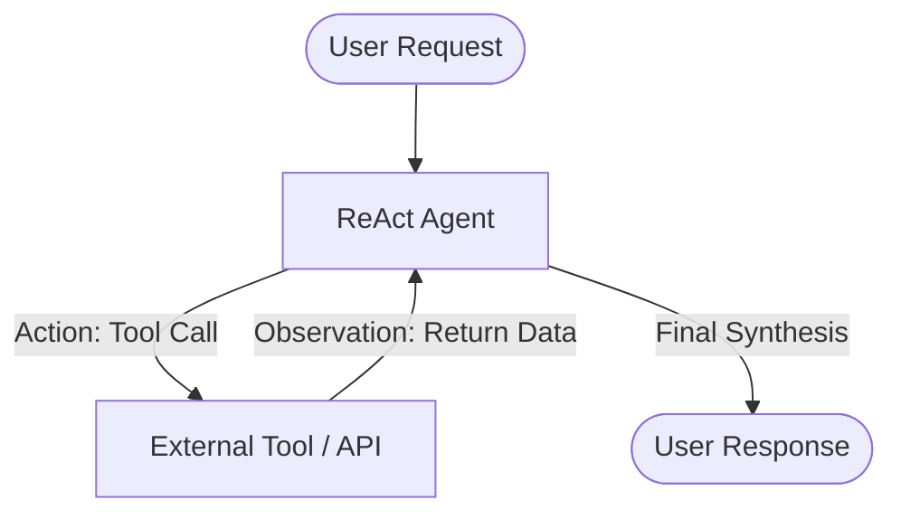
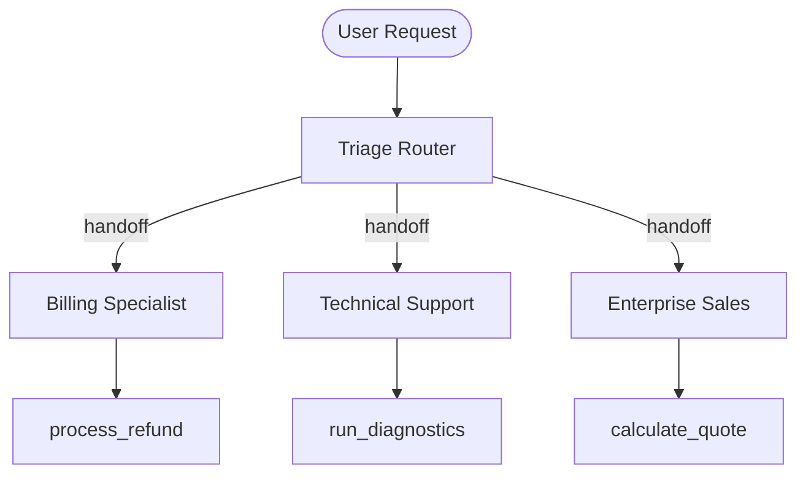
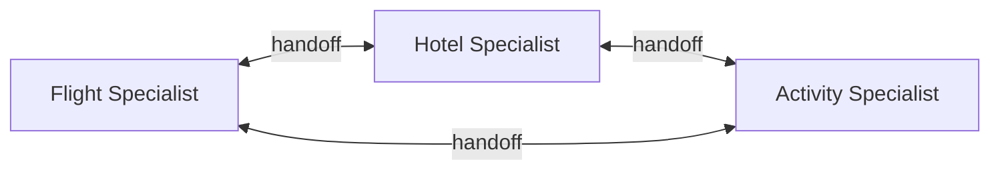
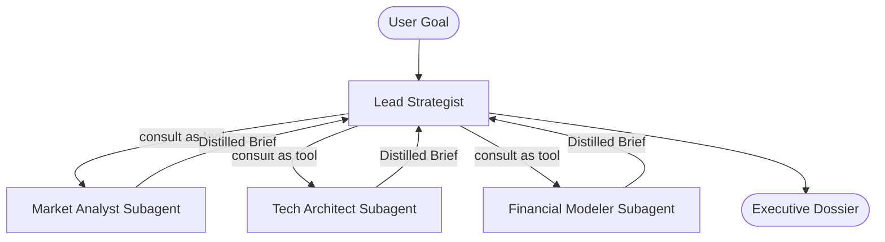
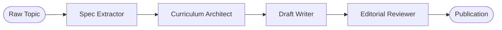
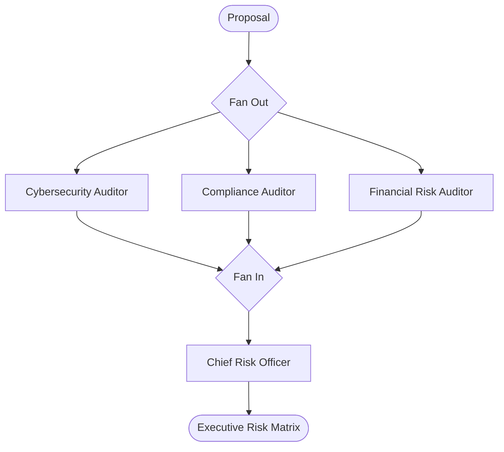
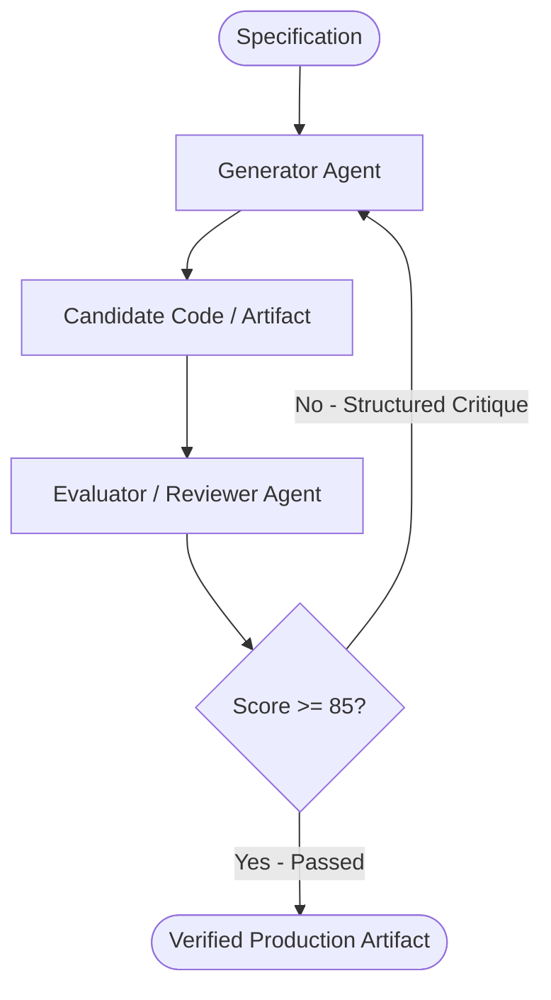
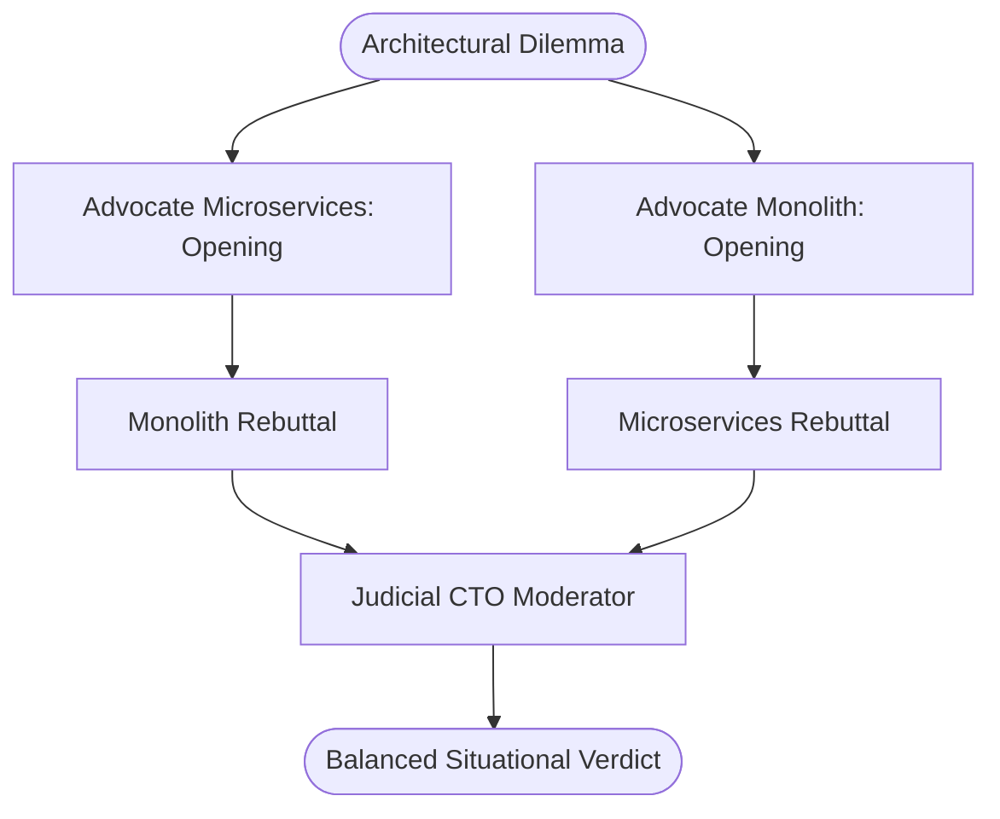
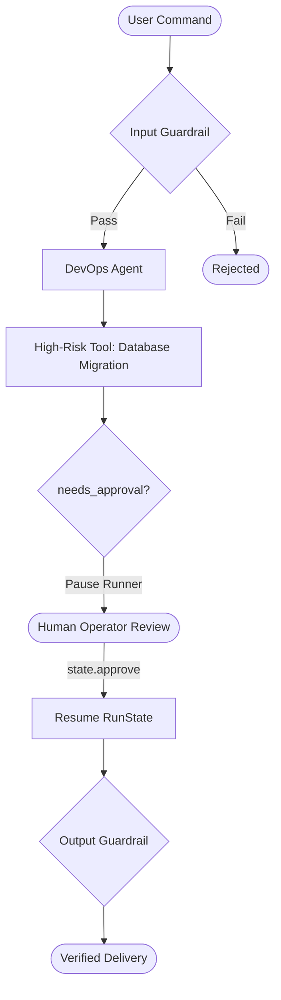
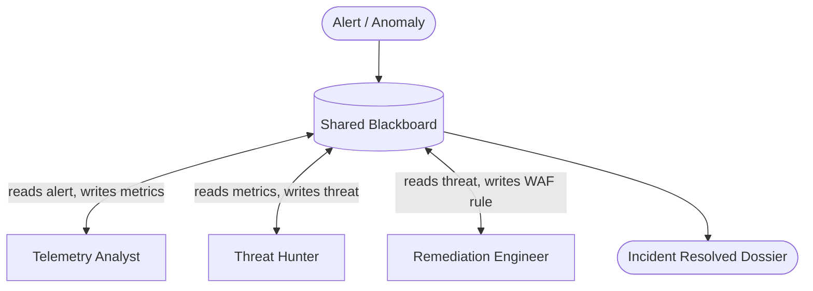

# The Definitive Multi-Agent Architecture Guide

An educational guide exploring multi-agent communication topologies, coordination mechanisms, and design trade-offs built on top of the **OpenAI Agents SDK**.

---

## Table of Contents
1. [The Evolution of Agent Architectures](#1-the-evolution-of-agent-architectures)
2. [Communication Topologies Taxonomy](#2-communication-topologies-taxonomy)
3. [The Trade-off Decision Matrix](#3-the-trade-off-decision-matrix)
4. [Handoff vs. Agent-as-a-Tool (Deep Dive)](#4-handoff-vs-agent-as-a-tool-deep-dive)
5. [Context Hygiene and Blast Radius](#5-context-hygiene-and-blast-radius)
6. [Common Anti-Patterns to Avoid](#6-common-anti-patterns-to-avoid)

---

## 1. The Evolution of Agent Architectures

In early LLM applications, developers relied on a **Single Mega-Prompt**: one massive system prompt containing dozens of instructions, few-shot examples, and ten or twenty callable tools.

### Why the Mega-Prompt Fails at Scale:
- **Attention Dilution & Needle-in-a-Haystack**: As prompt size grows, LLMs exhibit higher rates of hallucination and tool argument error.
- **Tool Collisions**: When two tools have overlapping descriptions (e.g., `lookup_user_by_email` vs `search_crm_contacts`), the model struggles to make deterministic decisions.
- **Context Pollution**: Irrelevant intermediate tool returns (e.g., 500 lines of raw JSON) remain in the context window for subsequent turns, increasing latency and cost.
- **Rigidity**: Modifying one prompt instruction inadvertently breaks behaviors elsewhere.

Multi-agent architectures decompose complex systems into **modular, loosely-coupled specialists**, each possessing a clear mandate, isolated instructions, and focused toolkits.

---

## 2. Communication Topologies Taxonomy

### Pattern 1: Single Agent ReAct (Point-to-Point Loop)
The agent operates in an autonomous loop of **Thought $\to$ Action $\to$ Observation $\to$ Reflection**.



- **Communication Mechanism**: In-context tool calling loop.
- **State Scope**: Single conversation context.

---

### Pattern 2: Router / Triage Dispatcher (Star / Hub & Spoke)
A lightweight front-door classifier analyzes intent and delegates conversation ownership to a specialized domain agent.



- **Communication Mechanism**: Zero-shot intent classification $\to$ SDK `handoff(target=...)`.
- **State Scope**: Conversation history travels with the handoff to the specialist. The router drops out of the loop.

---

### Pattern 3: Peer-to-Peer Swarm (Mesh Network)
Agents are organized as peers without a central supervisor. Any peer can hand off conversation control to any other peer as the conversation evolves.



- **Communication Mechanism**: Decentralized, bidirectional handoffs.
- **State Scope**: Shared linear conversation history, fluid ownership transitions.

---

### Pattern 4: Supervisor & Sub-Agents (Hierarchical Tree / Orchestrator-Workers)
A central coordinator retains conversational ownership and delegates subtasks to specialists packaged as tools (`agent.as_tool()`).



- **Communication Mechanism**: Call-and-return (`as_tool`).
- **State Scope**: Subagents execute in isolated sub-contexts; their internal tool chatter does NOT pollute the supervisor's context window.

---

### Pattern 5: Sequential Pipeline (Linear Chain / Assembly Line)
Workflows where output of Agent $N$ becomes structured input for Agent $N+1$.



- **Communication Mechanism**: Typed output-to-input handoff.
- **State Scope**: Discrete, stage-by-stage message transformation.

---

### Pattern 6: Parallel Fan-Out / Fan-In (Scatter-Gather / Map-Reduce)
Concurrently runs multiple specialized agents via `asyncio.gather()`, then synthesizes all perspectives.



- **Communication Mechanism**: Asynchronous parallel futures gathered into a synthesis prompt.
- **State Scope**: Zero cross-agent context leakage; pure functional fan-out/fan-in.

---

### Pattern 7: Evaluator-Optimizer (Generator-Critic Feedback Loop)
A generator produces candidate solutions, an evaluator grades against strict rubrics, and structured critique is looped back until quality convergence.



---

### Pattern 8: Multi-Agent Debate & Deliberation (Adversarial Roundtable)
Pits opposing advocates against each other across opening and rebuttal rounds, moderated by an impartial judge.



---

### Pattern 9: Human-in-the-Loop & Safety Guardrails (Guarded Gate)
Enforces safety boundaries using `@input_guardrail`, pauses high-risk actions using `needs_approval=True`, and cleans outputs with `@output_guardrail`.



---

### Pattern 10: Event-Driven Shared Blackboard (Decoupled Shared State)
Agents never call each other. They read and post facts to a central shared blackboard.



---

## 3. The Trade-off Decision Matrix

| Pattern | Topology | Latency | Token Cost | State Isolation | Failure Blast Radius | Best Suited For |
| :--- | :--- | :---: | :---: | :---: | :---: | :--- |
| **01. Single ReAct** | Loop | Low | Low | Low | Contained | Straightforward API queries, calculations |
| **02. Router / Triage** | Star | Low | Low | Moderate | Low | Multichannel Customer Support, Helpdesks |
| **03. Peer Swarm** | Mesh | Moderate | Moderate | Low | Moderate | Fluid exploratory journeys (Travel, Brainstorming) |
| **04. Supervisor** | Tree | Moderate | Moderate | High | Low | Complex strategy, multi-domain planning |
| **05. Pipeline** | Linear | Moderate | Moderate | High | Low | Publishing, ETL, Code migration |
| **06. Parallel Fan-Out** | Fork-Join | Fast (Concurrent) | High | Absolute | Isolated | Risk audits, comprehensive multi-angle reviews |
| **07. Evaluator-Optimizer**| Cyclic Loop | High (Multi-turn) | High | Moderate | Low | High-assurance code, SQL synthesis, contracts |
| **08. Multi-Agent Debate** | Roundtable | High | High | Low | Low | Ambiguous architectural decisions, policy |
| **09. Human-in-the-Loop** | Intercept Gate| Variable (Human) | Low | High | Minimal | Database wipes, financial operations, compliance |
| **10. Shared Blackboard** | Pub-Sub | Moderate | Moderate | Decoupled | Low | SOC incident response, multi-sensor autonomy |

---

## 4. Handoff vs. Agent-as-a-Tool (Deep Dive)

The distinction between `handoff` and `as_tool` is one of the most critical concepts in modern agent architecture:

```
+--------------------------------------------------------------------------------+
| Feature                     | Handoff (`handoff`)       | Agent-as-Tool (`as_tool`)  |
+-----------------------------+---------------------------+----------------------------+
| Conversational Ownership    | Transferred to new agent  | Retained by supervisor     |
| Conversation History        | Passes full transcript    | Passes isolated parameters |
| Subagent Intermediate Tool  | Visible to everyone       | Concealed inside sub-call  |
| Execution Return            | New agent talks to user   | Returns string to parent   |
| Mental Model                | "Transferring your call"  | "Consulting an expert"     |
+--------------------------------------------------------------------------------+
```

---

## 5. Context Hygiene and Blast Radius

### Context Hygiene
When subagents invoke tools that return huge payloads (thousands of lines of logs, database dumps, raw HTML), passing those payloads directly into the top-level conversation causes **Context Bloat**.

Using `subagent.as_tool()` enforces **Context Hygiene**: the subagent reads the massive payload in its own isolated turn, extracts the 2-sentence key finding, and returns only that finding to the supervisor.

### Failure Blast Radius
- In a **Peer Mesh**, an agent that hallucinated or failed to hand off correctly can derail the entire dialogue.
- In a **Supervisor-Subagent** or **Blackboard** architecture, an individual subagent failure is isolated: the supervisor or blackboard catches the error, re-dispatches, or asks an alternative agent.

---

## 6. Common Anti-Patterns to Avoid

1. **The Ping-Pong Loop**: Two peer agents continuously handing off to each other without making progress.
   - *Fix*: Limit `max_turns` in `Runner.run()` or enforce handoff preconditions.
2. **The Omniscient Subagent**: Giving subagents access to tools they don't need "just in case".
   - *Fix*: Adhere strictly to the Principle of Least Privilege for agent toolkits.
3. **Unbounded Evaluator-Optimizer**: An evaluator with an impossible rubric trapping the generator in an infinite retry loop.
   - *Fix*: Always enforce a hard ceiling on `max_iterations` (e.g. 3) and track progress metrics.
4. **Unguarded Dangerous Operations**: Allowing an agent to execute SQL `DROP` or cloud `DESTROY` without human interception.
   - *Fix*: Use `needs_approval=True` and verify tool call parameters explicitly before calling `state.approve()`.
