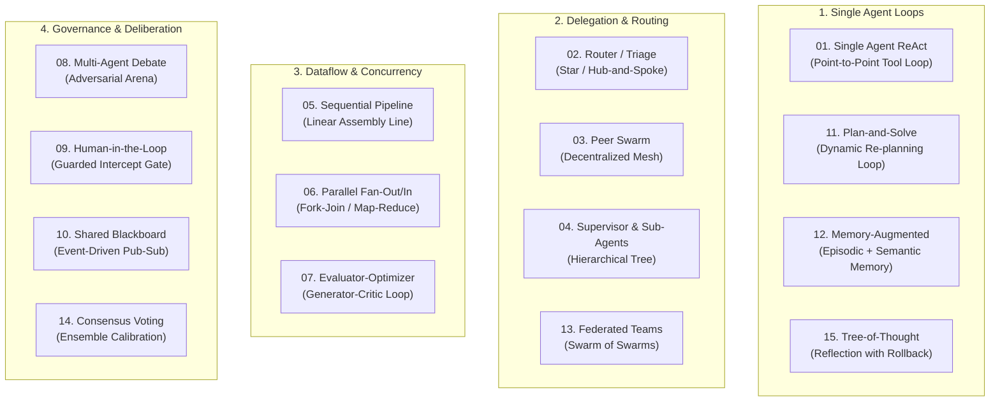

# The Definitive Multi-Agent Architecture Guide

An educational guide exploring multi-agent communication topologies, coordination mechanisms, and design trade-offs powered by **DeepSeek** via the **OpenAI Agents SDK**.

---

## Table of Contents
1. [The Evolution of Agent Architectures](#1-the-evolution-of-agent-architectures)
2. [Communication Topologies Taxonomy](#2-communication-topologies-taxonomy)
3. [The 15-Pattern Trade-off Decision Matrix](#3-the-15-pattern-trade-off-decision-matrix)
4. [Handoff vs. Agent-as-a-Tool (Deep Dive)](#4-handoff-vs-agent-as-a-tool-deep-dive)
5. [Context Hygiene and Blast Radius](#5-context-hygiene-and-blast-radius)
6. [Interactive Web Visualizer](#6-interactive-web-visualizer)
7. [Common Anti-Patterns to Avoid](#7-common-anti-patterns-to-avoid)

---

## 1. The Evolution of Agent Architectures

In early LLM applications, developers relied on a **Single Mega-Prompt**: one massive system prompt containing dozens of instructions, few-shot examples, and ten or twenty callable tools.

### Why the Mega-Prompt Fails at Scale:
- **Attention Dilution & Needle-in-a-Haystack**: As prompt size grows, LLMs exhibit higher rates of hallucination and tool argument error.
- **Tool Collisions**: When two tools have overlapping descriptions (e.g., `lookup_user_by_email` vs `search_crm_contacts`), the model struggles to make deterministic decisions.
- **Context Pollution**: Irrelevant intermediate tool returns (e.g., 500 lines of raw JSON) remain in the context window for subsequent turns, increasing latency and cost.
- **Rigidity**: Modifying one prompt instruction inadvertently breaks behaviors elsewhere.

Multi-agent architectures decompose complex systems into **modular, loosely-coupled specialists**, each possessing a clear mandate, isolated instructions, and focused toolkits.

---

## 2. Communication Topologies Taxonomy

The 15 patterns are categorized into 4 core architectural families:



---

## 3. The 15-Pattern Trade-off Decision Matrix

| # | Pattern Name | Topology | Latency | Token Cost | State Isolation | Failure Blast Radius | Primary Best-Fit Application |
| :-: | :--- | :--- | :---: | :---: | :---: | :---: | :--- |
| **01** | **Single ReAct** | Tool Loop | Low | Low | Low | Contained | Straightforward API queries, calculations |
| **02** | **Router / Triage** | Star Hub | Low | Low | Moderate | Low | Multichannel Customer Support, Helpdesks |
| **03** | **Peer Swarm** | Mesh Network | Moderate | Moderate | Low | Moderate | Fluid exploratory journeys (Travel, Brainstorming) |
| **04** | **Supervisor** | Tree Hierarchy | Moderate | Moderate | High | Low | Complex strategy, multi-domain planning |
| **05** | **Sequential Pipeline**| Linear Chain | Moderate | Moderate | High | Low | Publishing, ETL, Code migration |
| **06** | **Parallel Fan-Out** | Fork-Join | Fast (Concurrent)| High | Absolute | Isolated | Risk audits, comprehensive multi-angle reviews |
| **07** | **Evaluator-Optimizer**| Cyclic Loop | High (Multi-turn)| High | Moderate | Low | High-assurance code, SQL synthesis, contracts |
| **08** | **Multi-Agent Debate** | Roundtable Arena| High | High | Low | Low | Ambiguous architectural decisions, policy |
| **09** | **Human-in-the-Loop** | Intercept Gate | Variable (Human)| Low | High | Minimal | Database wipes, financial operations, compliance |
| **10** | **Shared Blackboard** | Pub-Sub Store | Moderate | Moderate | Decoupled | Low | SOC incident response, multi-sensor autonomy |
| **11** | **Plan-and-Solve** | Closed-Loop Plan| High (Adaptive) | High | High | Low | Multi-step software refactoring, scientific search |
| **12** | **Memory-Augmented** | Cognitive Tiers | Low | Low | High | Low | Persistent executive assistants, CRM profiles |
| **13** | **Federated Teams** | Swarm of Swarms| Moderate | Moderate | High | Isolated | Enterprise organizations mirroring Conway's Law |
| **14** | **Consensus Voting** | Blind Ensemble | Fast (Concurrent)| High | Absolute | Minimal | High-stakes zero-day CVE scoring, fraud triage |
| **15** | **Tree-of-Thought** | Branching Search| High (Search) | High | High | Resilient | Heuristic path planning, combinatorial optimization |

---

## 4. Handoff vs. Agent-as-a-Tool (Deep Dive)

The distinction between `handoff` and `as_tool` is the foundational divide in multi-agent systems:

```
+--------------------------------------------------------------------------------+
| Feature                     | Handoff (`handoff`)       | Agent-as-Tool (`as_tool`)  |
+-----------------------------+---------------------------+----------------------------+
| Conversational Ownership    | Transferred to new agent  | Retained by supervisor     |
| Conversation History        | Passes full transcript    | Passes isolated parameters |
| Subagent Intermediate Tool  | Visible to everyone       | Concealed inside sub-call  |
| Execution Return            | New agent talks to user   | Returns string to parent   |
| Mental Model                | "Transferring your call"  | "Consulting an expert"     |
+--------------------------------------------------------------------------------+
```

---

## 5. Context Hygiene and Blast Radius

### Context Hygiene
When subagents invoke tools that return huge payloads (thousands of lines of logs, database dumps, raw HTML), passing those payloads directly into the top-level conversation causes **Context Bloat**.

Using `subagent.as_tool()` enforces **Context Hygiene**: the subagent reads the massive payload in its own isolated turn, extracts the 2-sentence key finding, and returns only that finding to the supervisor.

### Failure Blast Radius
- In a **Peer Mesh**, an agent that hallucinated or failed to hand off correctly can derail the entire dialogue.
- In a **Supervisor-Subagent** or **Blackboard** architecture, an individual subagent failure is isolated: the supervisor or blackboard catches the error, re-dispatches, or asks an alternative agent.

---

## 6. Interactive Web Visualizer

To visualize all 15 topologies with live animated message flows and interactive node graphs, run:

```bash
python main.py visualizer
```

This launches a zero-dependency, local web application on `http://localhost:8000` with interactive SVG diagrams, metric cards, and step-by-step playback simulation.

---

## 7. Common Anti-Patterns to Avoid

1. **The Ping-Pong Loop**: Two peer agents continuously handing off to each other without making progress.
   - *Fix*: Limit `max_turns` in `Runner.run()` or enforce handoff preconditions.
2. **The Omniscient Subagent**: Giving subagents access to tools they don't need "just in case".
   - *Fix*: Adhere strictly to the Principle of Least Privilege for agent toolkits.
3. **Unbounded Evaluator-Optimizer**: An evaluator with an impossible rubric trapping the generator in an infinite retry loop.
   - *Fix*: Always enforce a hard ceiling on `max_iterations` (e.g. 3) and track progress metrics.
4. **Unguarded Dangerous Operations**: Allowing an agent to execute SQL `DROP` or cloud `DESTROY` without human interception.
   - *Fix*: Use `needs_approval=True` and verify tool call parameters explicitly before calling `state.approve()`.
