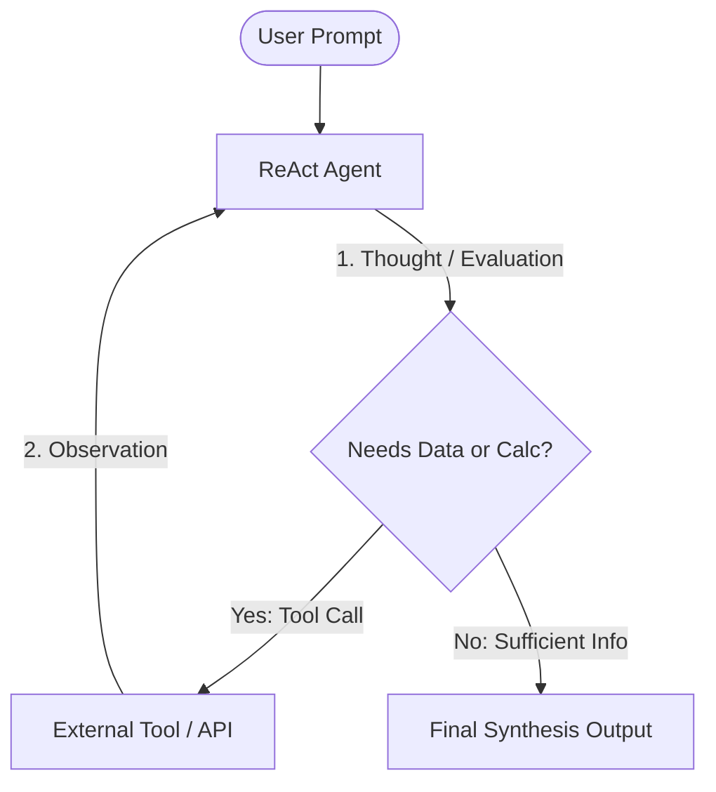

# Pattern 01: Single Agent ReAct (Reason + Act with Tools)

## Concept Overview
The **ReAct** (Reasoning + Acting) loop is the foundational atom of agentic systems. Rather than attempting to answer everything through static zero-shot generation, the agent loops continuously through perception, reasoning, tool execution, and observation until the task is complete.

## How Communication Works
1. **Perception**: The agent inspects the conversation history and user prompt.
2. **Reasoning**: The underlying LLM generates internal thoughts or plans.
3. **Action**: If external data or deterministic math is required, the model emits a structured function call matching the tool schema.
4. **Observation**: The `Runner` executes the local Python function and appends the result into the model's message context.
5. **Loop / Termination**: The model inspects the observation. If satisfied, it generates the final answer; otherwise, it emits another tool call.

## When to Use
- Single-domain queries requiring external data (stock prices, weather, database lookups).
- Calculations and deterministic transformations unsuitable for raw LLM arithmetic.
- Workflows that easily fit inside a single context window without overwhelming prompt instructions.

## When NOT to Use
- Workflows requiring dozens of conflicting tools or distinct personas.
- Long-running multi-stage tasks where token bloat degrades attention.
