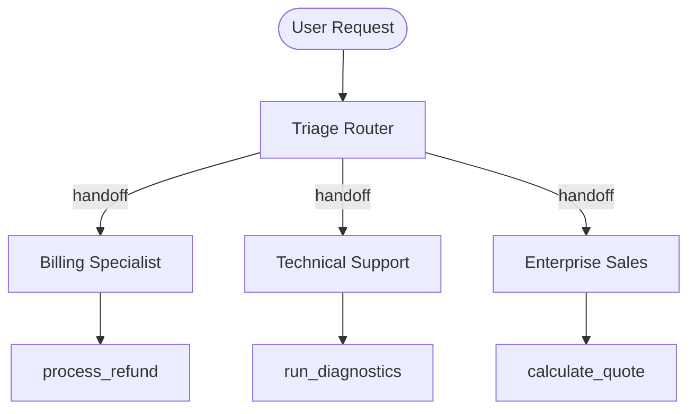

# Pattern 02: Router / Triage Dispatcher (Star Topology)

## Concept Overview
The Router (or Triage) pattern separates frontline classification from domain execution. A lightweight classifier determines the user's intent and immediately hands off ownership of the conversation to a dedicated domain specialist agent.

## How Communication Works
1. **Zero-Shot Intent Classification**: The Router inspects the user inquiry and matches it against available handoff definitions.
2. **SDK Handoff Execution**: The Router invokes the handoff routine. The OpenAI Agents SDK transfers conversation control and history to the target specialist.
3. **Router Exit**: The router drops out of the execution loop; subsequent responses originate directly from the specialist.

## Key Advantages
- **Eliminates Prompt Bloat**: Specialist agents only need domain-specific instructions and tools.
- **Prevents Tool Collisions**: Billing tools are never exposed to Technical Support agents.
- **Auditability**: Clean separation of functional concerns across enterprise departments.
