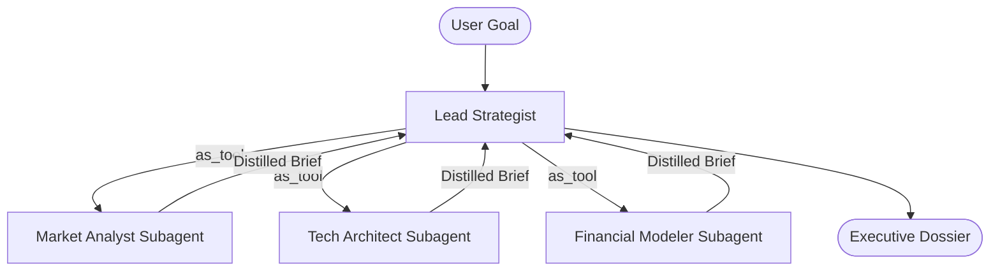

# Pattern 04: Supervisor & Subagents (Orchestrator-Workers)

## Concept Overview
The Supervisor & Subagents pattern organizes agents into a hierarchical tree. A central coordinator (the Supervisor) retains conversational ownership with the user and delegates targeted subtasks to specialist subagents packaged as callable tools via `subagent.as_tool()`.

## The Crucial Distinction: `handoff` vs `as_tool`
- In **`handoff`**, the target agent *takes over* the conversation thread and speaks directly to the user.
- In **`as_tool`**, the supervisor *retains control*. The subagent is executed as an isolated sub-task with its own local context. When finished, it returns a distilled string or structured object *back to the supervisor*, keeping the main conversation clean (**Context Hygiene**).

## When to Use
- Complex multidisciplinary projects (e.g. strategic planning, architectural audits).
- Preventing massive intermediate tool payloads from cluttering the user-facing transcript.
- Clear accountability: a single coordinator is responsible for the final output quality.
