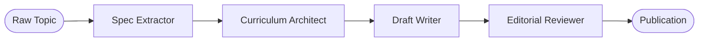

# Pattern 05: Sequential Pipeline (Assembly Line)

## Concept Overview
In a Sequential Pipeline, agents are arranged linearly in a deterministic chain ($A \to B \to C \to D$). Each agent serves as a specialized workstation on an assembly line, transforming intermediate artifacts from raw concepts into finalized deliverables.

## How Communication Works
- Execution flows sequentially via chained `Runner.run(...)` calls.
- The output of Stage $N$ is injected directly into the prompt or payload of Stage $N+1$.
- Each stage enforces its own specialized persona and quality bar without prompt interference.

## When to Use
- Content creation, documentation generators, and publication pipelines.
- Code migration, modernization, or translation pipelines.
- Any process requiring deterministic verification checkpoints between distinct phases.
