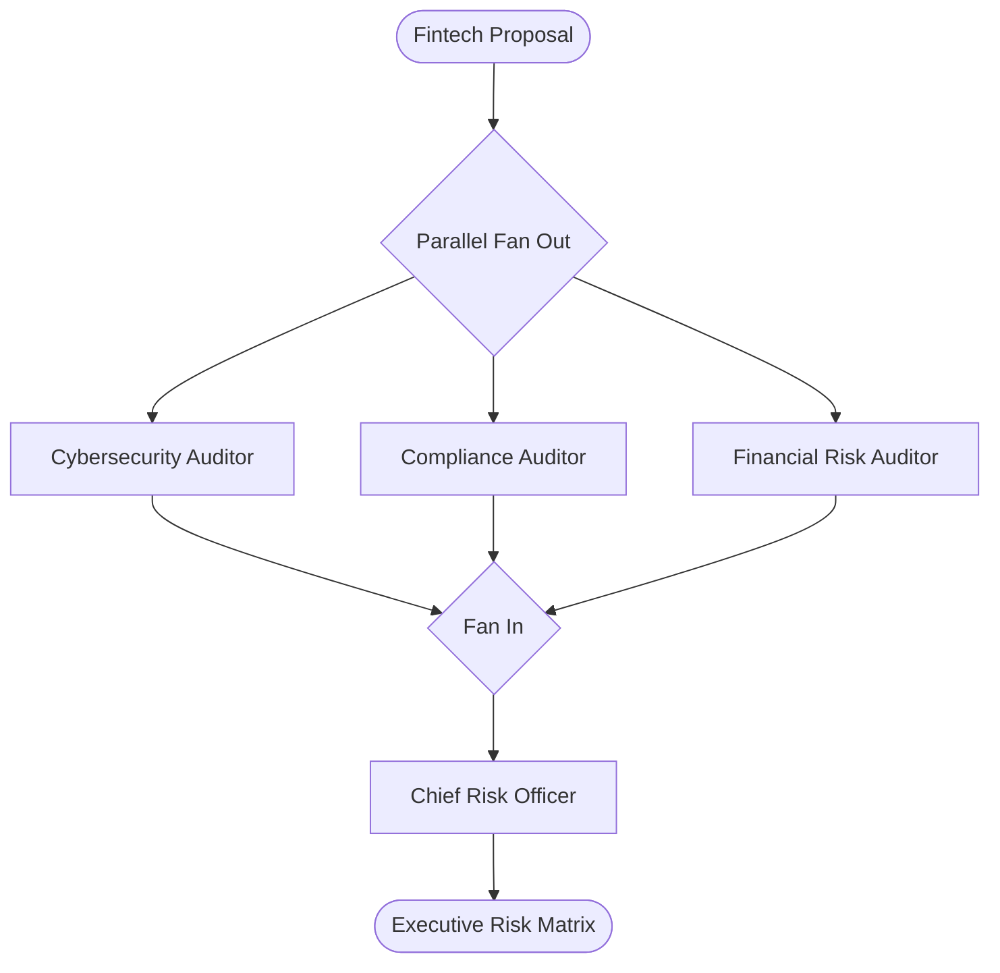

# Pattern 06: Parallel Fan-Out / Fan-In (Scatter-Gather)

## Concept Overview
When multiple specialized evaluations can be conducted independently, executing them sequentially wastes latency. The Parallel Fan-Out / Fan-In pattern achieves maximum concurrency by scattering tasks across multiple agents simultaneously, then gathering their findings into a synthesis agent.

## How Communication Works
- **Scatter (Fan-Out)**: Dispatches multiple `Runner.run` futures concurrently using `asyncio.gather(...)`.
- **Parallel Execution**: Each agent operates in isolation with zero inter-agent latency delays.
- **Gather (Fan-In)**: Once all futures complete, their respective `final_output` responses are bundled into a prompt for the aggregator agent.

## Latency Advantage
If each evaluation takes 5 seconds:
- Sequential Execution: $5s \times 3 = 15s$ + synthesis.
- Parallel Execution: $\max(5s) = 5s$ + synthesis.
