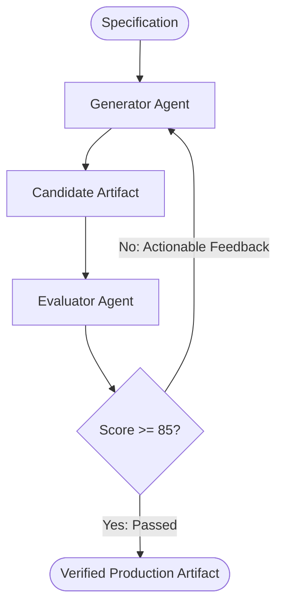

# Pattern 07: Evaluator-Optimizer (Generator-Critic Feedback Loop)

## Concept Overview
Single-pass generation frequently suffers from subtle bugs, missed edge cases, or compliance oversights. The Evaluator-Optimizer pattern implements an iterative self-refinement cycle: a Generator produces a candidate solution, an Evaluator grades it against an objective rubric, and structured critique is looped back until the solution meets a predefined quality bar.

## How Communication Works
1. **Candidate Generation**: The Generator drafts an implementation based on the user's specification.
2. **Strict Evaluation**: The Evaluator grades the candidate using a structured Pydantic schema (e.g. `score: int`, `passed: bool`, `weaknesses: list[str]`).
3. **Termination Condition**: If `passed == True` or `score >= threshold`, the loop breaks immediately.
4. **Targeted Refinement**: If flawed, the critique is formatted into the Generator's prompt, instructing it to address the identified issues.

## Safeguards
Always configure a hard ceiling on iterations (`max_iterations = 3`) to prevent runaway infinite loops when rubrics are difficult to satisfy.
