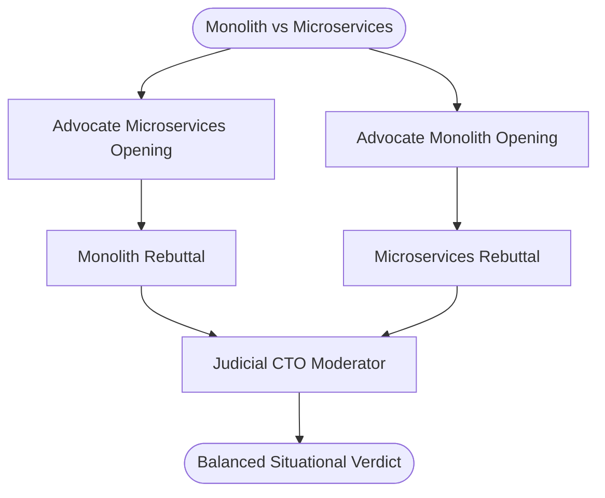

# Pattern 08: Multi-Agent Debate & Deliberation

## Concept Overview
When faced with ambiguous, multi-factor architectural or strategic dilemmas, asking a single agent usually results in agreeable blandness or bias toward the initial framing. Multi-Agent Debate introduces adversarial deliberation: two or more agents representing contrasting philosophies debate across rounds, and an impartial judge evaluates the arguments to reach consensus.

## How Communication Works
- **Round 1 (Opening)**: Each advocate presents their strongest affirmative arguments independently.
- **Round 2 (Rebuttal)**: Each advocate receives the opposing transcript, identifying fallacies, hidden operational costs, and invalid assumptions.
- **Round 3 (Consensus Adjudication)**: The Judicial Moderator evaluates both transcripts, assesses conceded points, and delivers a situational recommendation.

## When to Use
- Strategic technology decisions (e.g., SQL vs NoSQL, Cloud-Native vs Hybrid).
- Surfacing edge-case risks that a single agreeable agent would overlook.
- Legal briefs, investment thesis validation, and corporate policy reviews.
