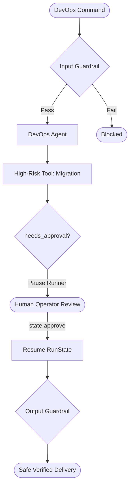

# Pattern 09: Human-in-the-Loop & Safety Guardrails

## Concept Overview
In enterprise systems, agents must not be allowed to execute irreversible or destructive mutations without authorization. The Human-in-the-Loop pattern creates an enforceable defense-in-depth architecture combining input guardrails, execution checkpoints, and output scrubbing.

## How Communication Works
1. **Input Guardrail (`@input_guardrail`)**: Scans user input before LLM execution, halting the runner if prompt injection or jailbreak patterns are detected.
2. **Tool Approval Checkpoint (`needs_approval=True`)**: When the agent attempts a dangerous action, the runner suspends execution and yields `result.interruptions`.
3. **Operator Intervention**: A human inspects the tool name and arguments. If consented, the operator calls `state = result.to_state(); state.approve(item)`.
4. **Resumed Execution**: Passing `state` into `Runner.run(agent, state)` resumes the loop seamlessly.
5. **Output Guardrail (`@output_guardrail`)**: Scans the response for sensitive tokens, private keys, or PII before returning it to the user.
