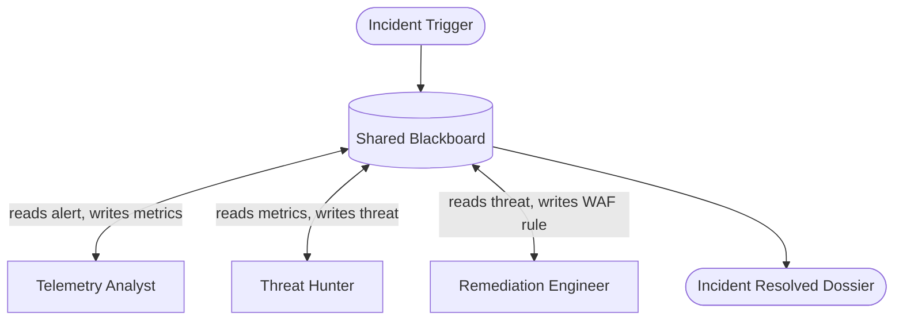

# Pattern 10: Event-Driven Shared Blackboard

## Concept Overview
Direct point-to-point connections between agents scale quadratically ($O(N^2)$), creating brittle dependencies. The Blackboard Pattern decouples agents completely: agents never invoke each other directly; instead, they observe and update a shared, central memory repository (the **Blackboard**).

## How Communication Works
- **Central State**: The Blackboard contains the incident state, timeline, telemetry data, verified facts, and applied mitigations.
- **Decoupled Specialists**: Specialist agents monitor the state of the blackboard. When preconditions are satisfied, an agent activates, performs its domain work, and posts findings back to the blackboard.
- **Emergent Problem Solving**: Complex issues are solved opportunistically as new facts are discovered and recorded.

## When to Use
- Security Operations Centers (SOC) and cyber-incident response.
- Fraud detection and complex forensic investigation.
- Systems where the exact sequence of troubleshooting steps cannot be predicted upfront.
