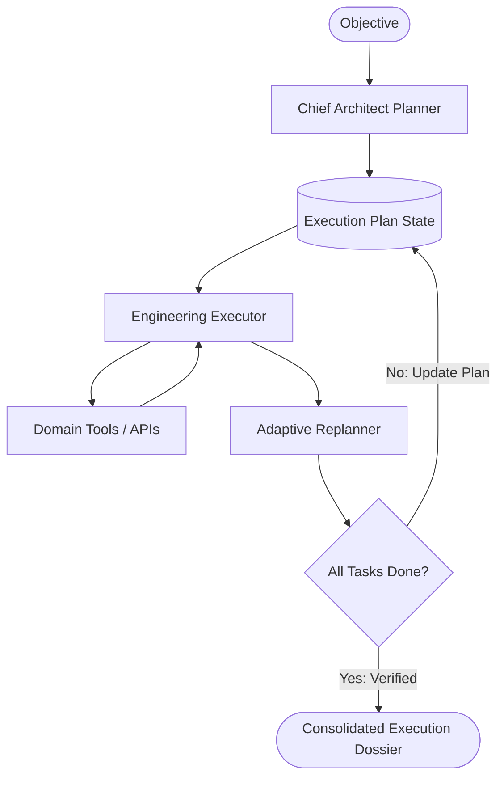

# Pattern 11: Dynamic Plan-and-Solve (Planner + Re-planning Execution Loop)

## Concept Overview
For long-horizon, multi-stage objectives, static execution plans fail as soon as early steps encounter unexpected errors, missing data, or new discoveries. The Dynamic Plan-and-Solve pattern implements a closed-loop control system:
1. **Planner Agent**: Decomposes a complex objective into an initial directed task list.
2. **Executor Agent**: Executes the current active step using domain tools.
3. **Replanner / Monitor Agent**: Inspects the step output, marks completed tasks as DONE, detects obstacles, and dynamically amends remaining steps based on live findings.
4. Loop terminates when the replanner verifies all criteria are satisfied.

## When to Use
- Complex, multi-stage software transformations or scientific research.
- Workflows where early steps reveal unknown facts that invalidate naive static plans.
- Autonomous agents requiring self-healing and adaptive problem solving.
