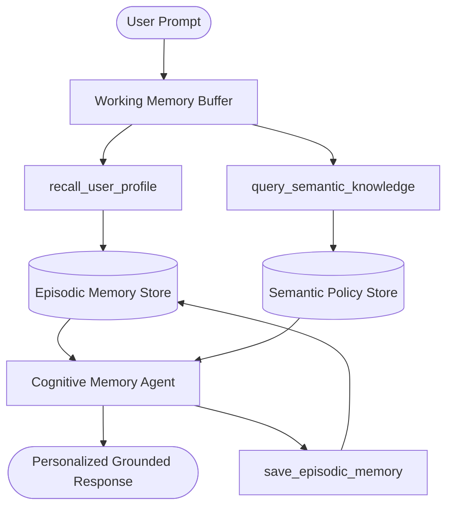

# Pattern 12: Memory-Augmented Architecture (Working + Episodic + Semantic)

## Concept Overview
Standard LLM agents suffer from catastrophic amnesia between turns or sessions. The Memory-Augmented Agent pattern models human cognitive memory tiers:
1. **Working Memory (Scratchpad)**: The immediate conversation context and active reasoning buffer.
2. **Episodic Memory (Events & Episodes)**: Timestamped records of past interactions, user preferences, decisions made, and user feedback.
3. **Semantic Memory (Knowledge Base)**: Searchable domain facts, company policies, and technical docs retrieved via semantic lookup.

## When to Use
- Long-running personal companions and customer relationship managers (CRM).
- Systems requiring personalization across sessions without stuffing mega-prompts.
- Domain agents that must adhere to evolving organizational knowledge and compliance rules.
