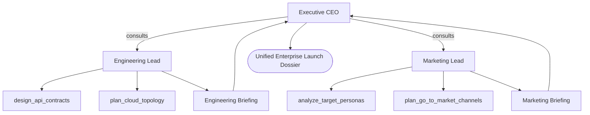

# Pattern 13: Federated Multi-Team Swarm (Hierarchical Swarm of Swarms)

## Concept Overview
As multi-agent systems expand to dozens of specialized agents, flat peer meshes degrade into chaotic handoff loops, while flat supervisor hierarchies suffer from coordinator bottlenecks. The Federated Multi-Team Swarm organizes agents according to Conway's Law:
1. **Executive Steering Council**: High-level strategic coordinator (CEO Agent).
2. **Autonomous Functional Clusters (Teams)**:
   - Engineering Cluster: Lead Architect + Backend Specialist + Cloud SRE.
   - Growth & Marketing Cluster: CMO + Growth Analyst + Content Strategist.
3. **Internal vs External Communication**:
   - Inside a cluster, peer agents collaborate closely using specialized domain tools.
   - Across clusters, only Team Leads communicate, presenting distilled department briefings via `as_tool()`.

## When to Use
- Enterprise-scale autonomous organizations (e.g. launching end-to-end software + marketing).
- Containing communication complexity inside modular department boundaries.
- Preventing specialized technical jargon from confusing commercial/marketing agents.
