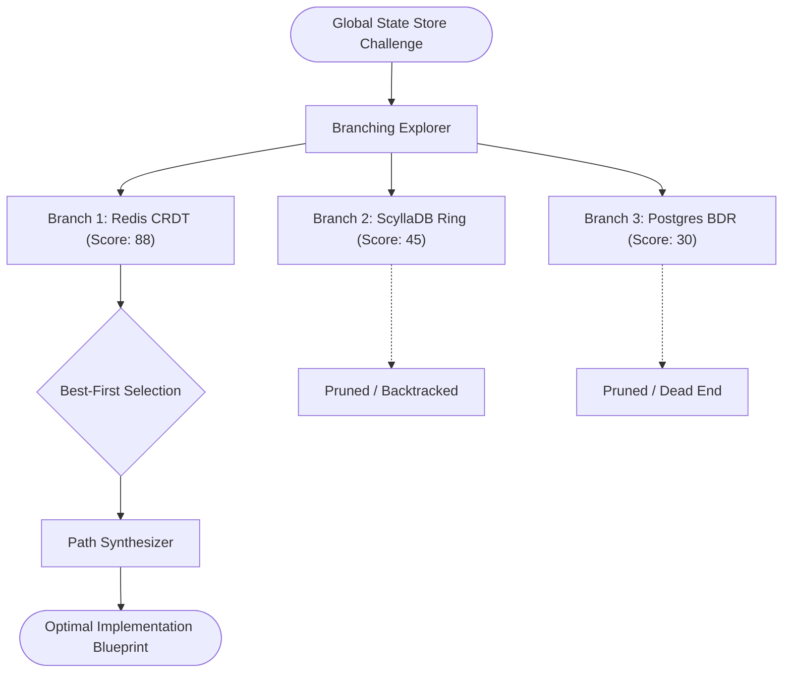

# Pattern 15: Tree-of-Thought & Reflection with Rollback (Branching Search)

## Concept Overview
Greedy linear agents make one choice at a time. If turn 3 hits an insurmountable obstacle, a standard agent has no way to backtrack and instead hallucinates or fails. The Tree-of-Thought & Reflection with Rollback pattern implements a heuristic search tree:
1. **Branching Generator**: From the current problem state, the agent generates $K=3$ distinct candidate strategies/approaches.
2. **State Value Evaluator**: An evaluation agent scores each candidate branch (0 to 100) on technical viability, complexity, and safety.
3. **Pruning & Rollback**: Branches scoring below a viable threshold (<50) are pruned. If an active branch encounters a dead end, execution rolls back to the parent junction and pivots to the highest-scoring alternate branch.
4. **Best-Path Synthesis**: The winning trajectory is expanded and delivered as the optimal solution.

## When to Use
- Complex optimization problems (database migration paths, algorithm design, route planning).
- Avoiding dead-end traps where early greedy decisions permanently ruin downstream steps.
- High-assurance planning requiring comparative trade-off exploration.
